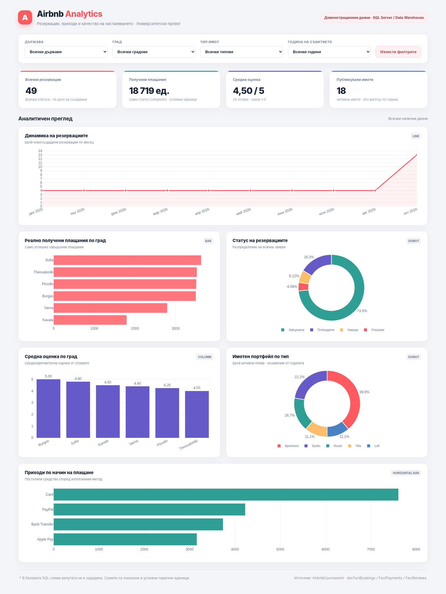

# Airbnb

Курсова работа по „Софтуерно моделиране и анализ“.

## Екип

| Име | Факултетен номер | Част |
| --- | --- | --- |
| Даниел Йорданов | 2401322019 | Концептуален и логически модел, база данни, процедури, функции, тригери |
| Християн Христов | 2401322018 | Data Warehouse модел и скриптове, Power BI и HTML доклад |

## Описание

Проектът моделира платформата Airbnb. Потребителите могат да бъдат домакини, които публикуват имоти, и гости, които ги резервират. Всеки имот има град, тип, удобства и снимки. Към резервациите има плащания и най-много едно ревю след приключил престой.

Пътят на данните е: **модели → релационна база `AirbnbDB` → Data Warehouse (схема `dw`) → Power BI доклад**.

## Структура

```text
2401322018_2401322019_Airbnb/
├── README.md
├── models/
│   ├── conceptual-model.drawio / .png       концептуален модел (Chen)
│   ├── logical-model.drawio / .png          логически модел (Crow's Foot)
│   └── data-warehouse-model.drawio / .png   Data Warehouse модел (UML)
├── database/
│   ├── 01-create-tables.sql
│   ├── 02-insert-data.sql
│   └── 03-programmability.sql
├── warehouse/
│   ├── 01-create-warehouse.sql
│   ├── 02-load-warehouse.sql
│   └── 03-validate-warehouse.sql
├── tests/
│   └── 01-programmability-tests.sql
├── powerbi/
│   ├── Airbnb_Analytics.pbix
│   ├── README.md
│   ├── measures.dax
│   ├── model_relationships.csv
│   ├── report_layout.md
│   └── queries/
├── data/                                    CSV експорт на DW таблиците
└── dashboard/
    ├── index.html                           HTML вариант на доклада
    ├── plotly.min.js
    ├── report_data.json
    └── preview.png
```

## Модели

- **Концептуален модел (Chen):** 9 обекта, връзки с кардиналности и връзка много към много между `Properties` и `Amenities`.
- **Логически модел (Crow's Foot):** 10 таблици и 50 колони с типове данни, PK, FK и UQ. Връзката много към много е реализирана чрез `PropertyAmenities`.
- **Data Warehouse модел (UML):** 3 таблици факти и 8 таблици измерения, свързани с 20 външни ключа.

Файловете `.drawio` се отварят с [diagrams.net](https://app.diagrams.net/). PNG файловете са за бърз преглед.

## Релационна база `AirbnbDB`

| Таблица | Съдържание |
| --- | --- |
| `Users` | Потребители, гости и домакини (`IsHost`) |
| `Cities` | Градове и държави |
| `PropertyTypes` | Типове имоти |
| `Properties` | Обяви с домакин, град, тип, цена и капацитет |
| `Amenities` | Удобства |
| `PropertyAmenities` | Връзка много към много между имоти и удобства |
| `PropertyImages` | Снимки на имотите |
| `Bookings` | Резервации |
| `Payments` | Плащания по резервациите |
| `Reviews` | По едно ревю за резервация |

Данните са: 15 потребителя, 8 града, 5 типа имоти, 20 имота, 12 удобства, 60 резервации, 80 плащания и 33 ревюта. Обхващат 14 месеца (октомври 2025 – декември 2026).

### Програмируеми обекти

| Обект | Тип | Какво прави |
| --- | --- | --- |
| `fn_CalculateStayPrice` | функция | Връща цената за престой: брой нощувки × цена на нощувка. |
| `fn_GetAverageRating` | функция | Връща средната оценка на имот от ревютата му. |
| `sp_CreateBooking` | процедура | Създава резервация със статус `Pending`. Проверява датите, броя гости, че домакинът не резервира собствения си имот и че няма припокриване с друга резервация. |
| `sp_CancelBooking` | процедура | Отказва резервация и маркира плащанията по нея като `Refunded`. |
| `tr_Payments_ConfirmBooking` | тригер | Потвърждава резервацията, когато сумата на плащанията покрие цялата цена. |
| `tr_Reviews_OnlyCompletedBookings` | тригер | Не позволява ревю за резервация, която не е приключила. |

## Data Warehouse

Таблиците са в схема `dw` на `AirbnbDB` и се зареждат от оперативните таблици със `warehouse/02-load-warehouse.sql`.

- **Факти:** `FactBookings`, `FactPayments`, `FactReviews`.
- **Измерения:** `DimDate`, `DimGuest`, `DimHost`, `DimProperty`, `DimLocation`, `DimPaymentMethod`, `DimBookingStatus`, `DimPaymentStatus`.

## Power BI доклад

`powerbi/Airbnb_Analytics.pbix` съдържа 4 показателя, 6 визуализации и филтри по държава, град, тип имот и година. Как се отваря и обновява е описано в [powerbi/README.md](powerbi/README.md).

`dashboard/index.html` е HTML вариант на същия доклад. Отваря се директно в браузър, а `plotly.min.js` трябва да е в същата папка.



## Инсталация и стартиране

Изисквания: **MS SQL Server 2019** или по-нов и **SQL Server Management Studio** (или Azure Data Studio / `sqlcmd`). За доклада трябва **Power BI Desktop**.

1. Клонирайте репото и отворете папката `course-work/Implementations/2401322018_2401322019_Airbnb`.
2. Изпълнете скриптовете по ред (в SSMS: **File → Open**, после **Execute**):

| Ред | Файл | Действие |
| ---: | --- | --- |
| 1 | `database/01-create-tables.sql` | Създава базата `AirbnbDB` и таблиците |
| 2 | `database/02-insert-data.sql` | Пълни таблиците с данни |
| 3 | `database/03-programmability.sql` | Създава функциите, процедурите и тригерите |
| 4 | `warehouse/01-create-warehouse.sql` | Създава схемата `dw` и DW таблиците |
| 5 | `warehouse/02-load-warehouse.sql` | Зарежда DW от оперативната база |
| 6 | `warehouse/03-validate-warehouse.sql` | Проверява DW и показва броя редове |
| 7 | `tests/01-programmability-tests.sql` | По желание: тества процедурите, функциите и тригерите и връща всички промени назад |

3. Отворете `powerbi/Airbnb_Analytics.pbix` и обновете данните от `AirbnbDB` по стъпките в [powerbi/README.md](powerbi/README.md).

С `sqlcmd` от папката на проекта:

```bash
sqlcmd -S localhost -U sa -P <парола> -C -i database/01-create-tables.sql
sqlcmd -S localhost -U sa -P <парола> -C -i database/02-insert-data.sql
sqlcmd -S localhost -U sa -P <парола> -C -i database/03-programmability.sql
sqlcmd -S localhost -U sa -P <парола> -C -i warehouse/01-create-warehouse.sql
sqlcmd -S localhost -U sa -P <парола> -C -i warehouse/02-load-warehouse.sql
sqlcmd -S localhost -U sa -P <парола> -C -i warehouse/03-validate-warehouse.sql
sqlcmd -S localhost -U sa -P <парола> -C -i tests/01-programmability-tests.sql
```

Скриптовете `database/01` и `warehouse/01` изтриват и създават таблиците наново. Затова цялата база може да се пресъздаде, като скриптовете се пуснат отново в същия ред.

## Примери

```sql
USE AirbnbDB;

SELECT dbo.fn_CalculateStayPrice(1, '2027-01-10', '2027-01-15');
SELECT dbo.fn_GetAverageRating(6);

DECLARE @BookingId INT;
EXEC dbo.sp_CreateBooking 1, 7, '2027-01-10', '2027-01-15', 2, @BookingId OUTPUT;
INSERT INTO Payments (BookingId, Amount, Method) VALUES (@BookingId, 475, 'Card');
SELECT Status FROM Bookings WHERE BookingId = @BookingId;
EXEC dbo.sp_CancelBooking @BookingId;

SELECT TOP (10) * FROM dw.FactBookings;
```
